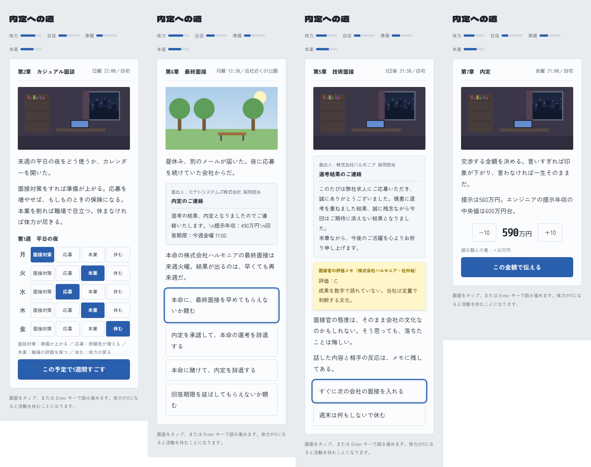

# 内定への道

受託開発5年目のエンジニアが、転職活動を通して「自分で選ぶ」ことを学んでいくノベルゲームです。ブラウザで `index.html` を開くだけで遊べます。



## 遊び方
- 画面をタップ（または Enter）で読み進め、選択肢を選びます。
- 体力・自信・準備・本業の4つの数値が、選考の結果や物語に影響します。
- エンディングは4種類。2周目からは、不採用のときに面接官の評価メモが読めます。

## ゲームの仕組み
- **転職サービスを選ぶ**：ドラフト型、GitHub連携型、IT専門エージェント（作中の名前はすべて架空です）
- **社風を読む**：会社ごとに評価される答え方（数字・協調・自走）が違います。手がかりは求人票と面接官の言葉です。
- **平日の夜**：月〜金の夜を、面接対策・応募・本業・休むに割り振ります。
- **並行選考**：本命の結果が出る前に、別の会社の内定期限が来ます。
- **バグ探し**：技術面接のライブコーディングで、障害を起こしたコードの原因を当てます。
- **年収交渉**：金額を自分で決めて伝えます。

## ファイル
- `index.html`：ゲーム本体（単体HTML、外部ライブラリなし）
- `docs/aruaru.md`：物語の元にした転職あるあると、エンジニア向け転職サービスの仕組みのメモ
- `qa/run.mjs`：ランダムに選択肢を選んで最後まで遊び、エラーとエンディングの到達数を確認するスクリプト（Playwright が必要。PR ごとに CI でも回る）

```
bash scripts/setup.sh   # 最初に一度（Node.js 22 が要る。Windows は Git Bash で）
node qa/run.mjs
```
